  

  

  <b>Student team from Tecnológico de Monterrey, Guadalajara campus.</b> 
  Ultra-efficient battery-electric prototypes for the <a href="https://www.makethefuture.shell/en-gb/shell-eco-marathon">Shell Eco-marathon</a> since 2021, 
  and an autonomy kit for Shell's Autonomous Driving Challenge since 2026.

  
  
  

<table align="center">
  <tr>
    <td align="center" width="25%"><h2>336</h2><b>km/kWh</b> best result, Shell Eco-marathon United States 2026</td>
    <td align="center" width="25%"><h2>30 kg</h2><b>lightest car</b> of the 2024 Americas competition</td>
    <td align="center" width="25%"><h2>4th</h2><b>in the Americas</b> in 2024 and again in 2025</td>
    <td align="center" width="25%"><h2>12×</h2><b>faster motor-control loop</b> 68 µs → 5.4 µs (bench, Nov 2026)</td>
  </tr>
</table>

We design the car ourselves: chassis and body, circuit boards, motor-control firmware, telemetry and the energy strategy.

---

## 🏁 Results

| Season | Event | Result | km/kWh |
|---|---|---|---:|
| 2026 | Shell Eco-marathon United States, Indianapolis | **6th place**, Prototype Battery Electric | **336** |
| 2025 | Shell Eco-marathon Americas | **4th place** | 293 |
| 2024 | Shell Eco-marathon Americas, Indianapolis | **4th place in the Americas** · lightest car of the competition (30 kg) | 302 |
| 2023 | Shell Eco-marathon Brazil, Rio de Janeiro | **6th place** · most efficient Mexican car in Shell Eco-marathon history | 235 |
| 2023 | Shell Eco-marathon Americas, Indianapolis | Debut · 2nd lightest car in the Americas (31 kg) | — |

On the same track, Indianapolis, we went from 302 km/kWh in 2024 to **336 in 2026 (+11 %)**. Results only compare fairly on the same circuit. Sources and season pages: [`team-portfolio`](https://github.com/ELYOS-Racing/team-portfolio).

## 📅 Season 2027

| When | What |
|---|---|
| **6–10 April 2027** | Shell Eco-marathon United States, Indianapolis Motor Speedway: 4 laps, 15.33 km, 35 minutes |
| April 2027 | First public demo of the autonomy kit |
| **June 2027** | Autonomous Driving Challenge, Silesia Ring, Poland. Our aim is to become the first team from the Americas to complete ADC attempts |

> **Where the next kilometres come from.** Our 2026 attempts were consistent, five valid runs within about 8 % of each other, so the gap to the winner is in the car, not the driving. Our energy model ranks where it is. For 2027 we are replacing the hub motor with a chain drive and clutch (about 20 % less energy in the model), measuring rolling resistance and drag with coast-down tests, and putting every milliwatt of electronics on a budget.

## 🔧 What we build

| Area | What it is | Highlights |
|---|---|---|
| 🏎️ **Mechanics** | A three-wheeled monocoque prototype with partial-Ackermann steering and hydraulic brakes | 30 kg in 2024; a chain drive with a clutch for 2027 |
| 🔌 **Electronics** | Our own 48 V, 45 A motor-driver board and telemetry board | Moved from Altium to KiCad and verified against the original gerbers; electrical and design-rule checks on every change |
| ⚡ **Motor driver** | Field-oriented control (FOC) of a BLDC motor on an ARM Cortex-M7 at 600 MHz | 10 kHz current loop in a hardware interrupt; current sampling synchronized with the PWM; sensorless observer in development |
| 📡 **Telemetry** | Sensors, sensor fusion, logging and a live link to the pits; cockpit display for the driver | A predictive co-pilot trained in simulation that tells the driver when to accelerate and when to coast |
| 🔋 **Energy strategy** | A metre-by-metre model of the car and the track | Optimal control and genetic algorithms for the speed profile; a loss budget that ranks where every watt goes; motor, gear and clutch choices backed by thousands of simulated attempts |
| 🔗 **Inter-board protocol** | One versioned binary protocol shared by every board | Frozen golden test vectors, CRC on every frame, C and Python implementations checked byte by byte |
| 📊 **Pit dashboard** | Live telemetry, laps and race control for the pit crew | Real-time push to every screen; session export for analysis |
| 🤖 **Autonomy** | A removable autonomy kit on the 2026 car | ROS 2 stack (localization, perception, planning, control, safety); software-in-the-loop tests and a digital twin in Gazebo and NVIDIA Isaac Sim |

## 🛠️ Technology

<table>
  <tr><td><b>Embedded</b></td><td>
    
    
    
    
     
    
    
    
  </td></tr>
  <tr><td><b>Electronics</b></td><td>
     
    
    
    
  </td></tr>
  <tr><td><b>Mechanical</b></td><td>
     
    
    
  </td></tr>
  <tr><td><b>Simulation and optimization</b></td><td>
    
    
    
     
    
    
    
  </td></tr>
  <tr><td><b>Autonomy</b></td><td>
    
    
    
    
     
    
    
    
  </td></tr>
  <tr><td><b>Data and web</b></td><td>
    
    
    
    
     
    
    
    
    
  </td></tr>
  <tr><td><b>Engineering practice</b></td><td>
     
    
    
    
  </td></tr>
</table>

Bright badges are the core stack; the dark ones are the tools around it.

## 🧭 How we work

- **Every change goes through a pull request** with automated checks. On the firmware that controls 48 V, safety-critical changes also need a recorded bench session before they count as done.
- **Agreements between areas are written down:** interface control documents for connectors and protocols, and architecture decision records for choices that cross areas.
- **Season gates and a code freeze** two weeks before the event, with a guaranteed fallback: the version that raced last season is always kept ready.
- **Measure, don't assume.** Every number in our models says whether it was measured or assumed, and the tests that will replace the assumptions are planned.
- **Built for new members.** Every repository has an entry guide written for first-year students: the minimum theory, the algorithms explained, a reading order and exercises.

## 👥 Members

Each member's work, season by season, is in the team's public portfolio: [`team-portfolio`](https://github.com/ELYOS-Racing/team-portfolio). The vehicles' code is private; members' contributions show on their profiles as private contributions.

Team member? Sign in with your GitHub account to see the members-only "Start here" guide.

  

